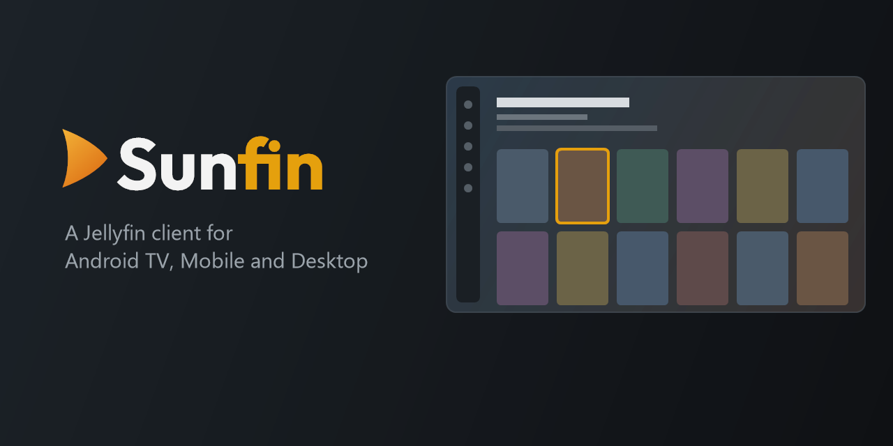

<p align="center">
  
</p>

> **DISCLAIMER:** This is a Jellyfin client inspired by the Plex UI and heavily catered to those who are used to the Plex UI with all the benefits of Jellyfin's Open Source Server. If you would like a more customisable experience see [Moonfin](https://github.com/Moonfin-Client/Moonfin-Core) which this Client is forked off of.

---

Sunfin is a Jellyfin client built with Flutter. It is made first for the living room: a slim left rail, a header that describes whatever you are focused on, portrait poster rows, and backdrop art that fades into a page tinted with the art's own colours. Every screen is built for a remote, with a D-pad path to everything.

> **Sunfin is a fork of [Moonfin](https://github.com/Moonfin-Client/Moonfin-Core)** (GPL-2.0), forked at Moonfin 2.7.0. All the hard work of the core client — playback, offline downloads, server support, the settings system and much more — comes from the Moonfin authors. Sunfin is an independent project and is not affiliated with or endorsed by Moonfin, Jellyfin or Emby.

## What Sunfin changes

- **A fixed TV look.** Sunfin's look is the product, so the theme, layout and style settings are locked on TV. What you see stays yours: which libraries, home rows, sidebar items and detail buttons show up, and in what order.
- **Home:** a header with the focused title's details over sharp backdrop art, poster rows below, no media bar.
- **Details pages:** dedicated movie, show and season pages with a Play/Resume button, a rating line, media chips, season tabs and an episode row.
- **Library pages:** a tabbed library page (Recommended and Library) with a letter jump bar, sort and filter menus, and a Back key that returns to the top before it leaves.
- **Page tint:** each page takes four corner colours from the backdrop and blends them across the screen.
- **Settings transfer:** export every setting to your own Jellyfin account and import it on another device. Sign-ins never travel; each device signs in on its own with Quick Connect.
- **No automatic settings sync:** settings only move when you export and import them.
- **Server administration on Windows and phones** (administrators only).

Phones and Windows currently use Moonfin's layouts with Sunfin's branding and colours.

Sunfin is pre-release (version 0.x). Push notifications from the Moonfin server plugin are not supported, because they depend on Moonfin's own Firebase project.

## Platforms

| Platform    | Status                                                         |
| ----------- | -------------------------------------------------------------- |
| Android TV  | Main target (tested on NVIDIA Shield TV)                       |
| Android     | Phones and tablets, Moonfin's mobile layout                    |
| Windows     | Portable build, TV look with keyboard and mouse                |
| Others      | iOS, macOS, Linux, tvOS and web live on the [`experimental`](https://github.com/sunfin-dev/sunfin/tree/experimental) branch until they have been built and tested for Sunfin |

## Building

You need Flutter 3.47.2, JDK 17 and, for Android, the Android SDK (platform 36) and NDK 28.2.

```sh
flutter pub get

# Android TV (release)
flutter build apk --flavor androidTv --release --target-platform android-arm,android-arm64

# Android phone (release)
flutter build apk --flavor mobile --release

# Windows (portable folder under build/windows)
flutter build windows --release
```

The Android app id is `dev.sunfin.app`. Release builds are signed with `android/app/release.keystore` and the passwords in `android/keystore.properties` (`storePassword`, `keyPassword`, `keyAlias`, optional `storeType`). Without them the build falls back to the debug key, which is fine for local testing but not for publishing. Never commit either file.

## Contributing

Issues and pull requests are welcome at <https://github.com/sunfin-dev/sunfin>. Changes that are not specific to Sunfin's look are often better sent to [Moonfin](https://github.com/Moonfin-Client/Moonfin-Core) first, so that both projects benefit.

## License

Sunfin is licensed under the **GNU General Public License v2.0**, the same license as Moonfin. See [LICENSE](LICENSE). Copyright for the original code stays with the Moonfin authors, and for the changes with the Sunfin contributors.

Plex, Jellyfin and Emby are trademarks of their respective owners. Sunfin is not affiliated with or endorsed by any of them.
